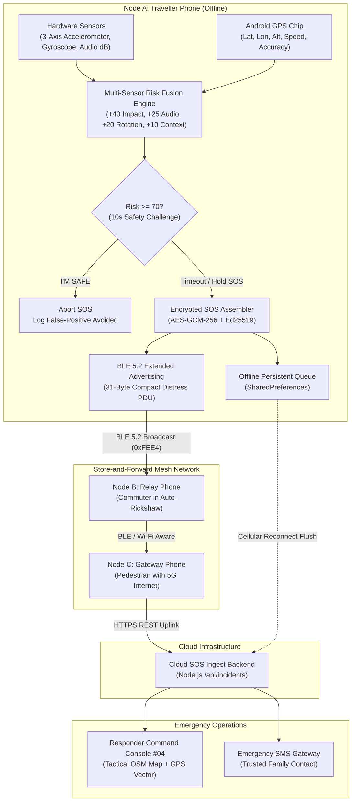

# Travel SOS Mesh — Technical Architecture Specification (SC-03)

**Team:** Maravazha  
**Members:** Vijaygovind Biju, Noel Paul Tomy  
**Challenge:** SC-03 — Late-night journey safety companion  
**System Target:** Native Android (Flutter + Android SDK) + Node.js Ingest Backend  

---

## 🏛️ High-Level System Architecture

---

## 🧮 Hardware Telemetry Mathematics

### 1. Accelerometer G-Force Magnitude
Using linear device acceleration $a_x, a_y, a_z$ (gravity-compensated in $\text{m/s}^2$):
$$G = 1.0 + \left(\frac{\sqrt{a_x^2 + a_y^2 + a_z^2}}{9.80665}\right)$$
*Impact Candidate Trigger:* $G \ge 3.8\text{G}$.

### 2. Gyroscope Angular Velocity Magnitude
Using rotational velocities $\omega_x, \omega_y, \omega_z$ in radians per second:
$$\Omega = \sqrt{\omega_x^2 + \omega_y^2 + \omega_z^2} \times \left(\frac{180}{\pi}\right) \quad (^\circ/\text{s})$$
*Rollover / Tumbling Candidate Trigger:* $\Omega \ge 80^\circ/\text{s}$.

### 3. Acoustic Anomaly Detection (Privacy-Preserving Decibels)
Calculates root-mean-square (RMS) sound pressure level without persisting or transmitting raw audio samples:
$$\text{dB} = 20 \log_{10}\left(\frac{\text{RMS}}{P_0}\right)$$
$$\text{Classification} = \begin{cases} \text{ANOMALY} & \ge 80\,\text{dB} \text{ (screams, glass shatter, metal crash)} \\ \text{ELEVATED} & 65 - 79\,\text{dB} \text{ (cabin noise, honks)} \\ \text{NORMAL} & < 65\,\text{dB} \text{ (nominal ambient)} \end{cases}$$

### 4. Multi-Sensor Risk Fusion & False-Positive Damping
$$\text{Score} = \text{Score}_{\text{Impact}} (40) + \text{Score}_{\text{Audio}} (25) + \text{Score}_{\text{Rotation}} (20) + \text{Score}_{\text{LateNight}} (10)$$
**Damping Guard:** No single isolated sensor anomaly can breach the trigger threshold ($70/100$) on its own, preventing dropped phones or loud traffic from triggering emergency services.

---

## 📦 31-Byte Compact BLE Distress Beacon PDU

Designed to fit within standard Bluetooth Low Energy advertising limits:

| Offset (Bytes) | Field Name | Size | Encoding / Format |
| :--- | :--- | :--- | :--- |
| `0x00` | AD Length | 1 Byte | `0x1E` (30 bytes follows) |
| `0x01` | AD Type | 1 Byte | `0x16` (Service Data - 16-bit UUID) |
| `0x02 - 0x03` | Service UUID | 2 Bytes | `0xFEE4` (Safety Emergency Beacon) |
| `0x04 - 0x07` | Message Hash | 4 Bytes | CRC32 / UInt32 Hash of Message ID |
| `0x08 - 0x0B` | Latitude | 4 Bytes | Fixed-Point Int32 ($\text{Lat} \times 10^5$, $\pm1.1\text{m}$ resolution) |
| `0x0C - 0x0F` | Longitude | 4 Bytes | Fixed-Point Int32 ($\text{Lon} \times 10^5$) |
| `0x10` | Accuracy | 1 Byte | UInt8 meters ($0 - 255\text{m}$) |
| `0x11` | Battery Level | 1 Byte | UInt8 percentage ($0 - 100\%$) |
| `0x12` | Risk Score | 1 Byte | UInt8 score ($0 - 100$) |
| `0x13` | Hop Count | 1 Byte | Nibble encoding (Hop count & TTL) |
| `0x14 - 0x1B` | Encrypted Token | 8 Bytes | Truncated AES-GCM-256 Authentication Tag |
| `0x1C - 0x1E` | Checksum | 3 Bytes | 24-bit Cyclic Redundancy Check |

---

## 🔒 Zero-Knowledge Security & Privacy Principles

1. **Zero Audio Recording:** The microphone evaluates acoustic volume solely in RAM; raw audio is never recorded, stored in persistent files, or uploaded.
2. **Ephemeral Geolocation:** GPS coordinates are packaged into an encrypted AES-GCM-256 envelope only when an active SOS is created.
3. **Zero-Knowledge Relays:** Intermediary nodes B and C can inspect only routing headers (hop count, TTL, packet hash) to forward the packet; they cannot decrypt the traveller's identity or coordinates.
4. **Tamper-Evident Incident Chaining:** Every state transition computes a rolling cryptographic event hash ($H_n = \text{Hash}(H_{n-1} \parallel \text{Event}_n)$), providing an immutable audit trail for emergency responders.
